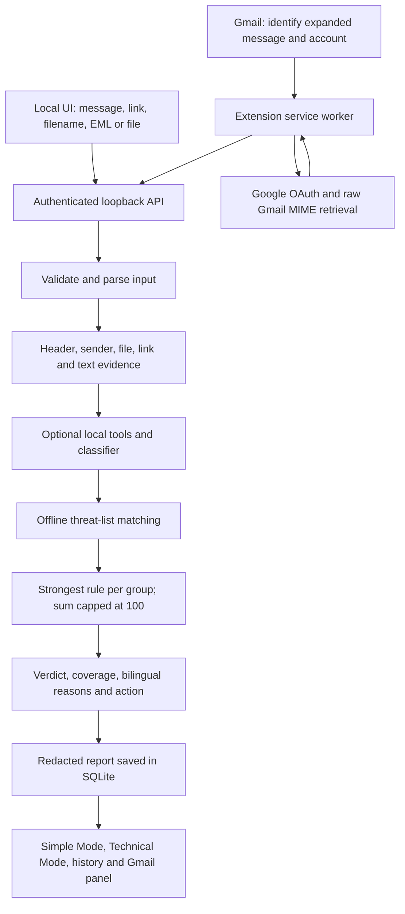

# PhishGuard — current pipeline and implementation

Updated: 17 October 2026. This document replaces the old cloud/Gemini pipeline description and describes the active local-first application. Optional features and unverified behavior are identified explicitly.

## 1. Architecture

PhishGuard converts technical warning evidence into one verdict, up to three short reasons, and one action. Simple Mode, Technical Mode and Gmail use the same backend result. English/Hindi explanations are predefined, not generated by an LLM.



| Component | Active source |
|---|---|
| HTTP server, access control, startup and API | `backend/local_app.py` |
| Parsing, evidence, scoring and response | `backend/local_core/engine.py` |
| SQLite storage | `backend/local_core/store.py` |
| Offline feed import/matching | `backend/local_core/feeds.py` |
| Optional classifier | `backend/local_core/classifier.py` |
| Optional file inspection worker | `backend/local_core/optional_files.py` |
| Signature and sender checks | `backend/forensics/file_signatures.py`, `domain_similarity.py` |
| Local React application | `frontend/src/LocalApp.jsx` |
| Gmail retrieval and API transport | `extension/local-background.js` |
| Gmail locator and inline panel | `extension/local-content.js` |
| Extension setup controls | `extension/options.html`, `options.js` |

Core analysis requires no cloud key or network access. Gmail needs Google OAuth and connectivity to Google to retrieve messages.

## 2. Startup, code generation and pairing

The development launch command from the repository root is:

```powershell
.\.venv\Scripts\python.exe backend/local_app.py
```

Build the frontend into `frontend/dist` first. The Python server binds only to `127.0.0.1:5000`, opens SQLite, attempts to load the optional model, prints the URL/code, and opens a browser unless `--no-browser` or `--background` is supplied.

The eight-character code is generated with `secrets.token_hex(4).upper()` on every launch. It stays in process memory, expires after ten minutes and is displayed in the console. It is not a Google code. Restarting produces a new code; closing the console stops protection.

- `/api/unlock` exchanges the valid code for a random UI session. Its cookie is HttpOnly and SameSite=Strict with a 12-hour lifetime. Sessions are held in memory and disappear on restart.
- `/api/pair` requires the code and a Chrome-extension Origin. It creates a random bearer token and saves the extension ID/token in SQLite. Chrome saves the token in local extension storage restricted to trusted extension contexts. Pairing persists across app restarts; pairing again replaces the old token.
- `/api/unpair` revokes local extension pairing. Google sign-out is separate.

Windows login startup is opt-in and implemented only for the packaged executable through the current user's Run registry entry. Source Python launches cannot enable it. Login-cycle behavior remains unverified.

## 3. Input and API validation

All supported inputs converge on `POST /api/analyze` and `engine.analyze()`.

| Input type | Payload | Work performed |
|---|---|---|
| `message` | Pasted text | Text patterns, links, indicators, optional classifier and feed matches |
| `link` | One HTTP(S) URL | Structure and offline reputation; no destination visit |
| `filename` | Name only | Extension/disguise checks; contents unavailable |
| `email` | Filename and base64 EML | MIME, headers, text, links and attachments |
| `file` | Filename and base64 bytes | Static file checks and optional worker |

The endpoint accepts only `input_type`, `content`, `filename`, `raw_base64`, and optional `gmail_message_id`. Supplied values must be strings. Unexpected fields, malformed base64 and invalid JSON/content types are rejected. Gmail correlation IDs must contain 8–32 hexadecimal characters.

| Resource | Bound |
|---|---|
| JSON request body | 14 MiB |
| Decoded file/email | 10 MiB |
| Direct input text | 100,000 characters |
| Filename | 1,000 characters |
| MIME traversal | 100 parts, depth 20 |
| Attachments per email | 20 |
| URL candidates | First 200 |
| Concurrent analysis jobs | Two; additional jobs receive HTTP 429 |
| Request rate | 120/minute per client IP |
| Connection timeout | 15 seconds |

Oversized direct text is rejected. Text assembled from MIME/OCR is truncated at 100,000 characters with an incomplete-check entry. The first-200 URL cap currently has no dedicated truncation warning; this is a reporting gap.

## 4. Gmail retrieval and result delivery

1. The content script runs on Gmail. Every 1.5 seconds it looks for visible elements with `data-legacy-message-id` and a visible `.ii.gt` body. It does not guess message IDs from inbox rows or routes.
2. It mounts a separate panel for each identifiable expanded message. Gmail DOM is used for identification, not body reconstruction.
3. Account detection extracts addresses from anchor/button ARIA labels and requires exactly one unique account address. Missing/ambiguous values fail closed.
4. The script sends the ID, account and automatic/manual flag to the service worker. Automatic checks default on and can be disabled; manual checks remain available.
5. The worker restricts callers to the extension options page or Gmail context, validates the ID, checks the automatic setting and connected account, and checks local-server availability.
6. An in-memory cache maps account/message to local analysis UUID. A cache hit retrieves the saved report and verifies its Gmail ID. The cache holds at most 100 entries and disappears when the worker restarts; SQLite reports persist.
7. Otherwise Chrome Identity supplies an OAuth token. Interactive consent occurs through **Connect Gmail**, not automatic scanning. The worker retrieves the Google profile and verifies the account again.
8. It requests `users/me/messages/{id}?format=raw`. The returned ID must match and raw MIME must exist. There is no mailbox-wide search or scan.
9. Gmail base64url is converted to standard base64 and sent to the paired loopback API. The result's Gmail ID must match before display.
10. The panel renders the shared result. **Full technical report** opens `/?mode=technical&analysis=<UUID>` and loads the cached report, after local unlocking if required.

Route generations, request sequence numbers, connected-node checks and message-ID checks prevent delayed results from appearing on a different email. Removed/changed message nodes dispose their panels. Server status is polled every ten seconds.

The inbox list has no expanded email to identify. Its manual fallback now asks the user to open/expand an email. Connection status preserves backend errors rather than always assuming the server stopped.

Google's `gmail.readonly` permission is mailbox-wide even though PhishGuard requests only the selected message. Tokens remain in Chrome Identity, not content scripts. Sign-out clears cached tokens and attempts Google revocation. The public client ID is configured in the manifest; setup and the expected extension ID are documented in `docs/GMAIL_SETUP.md`.

**Live Gmail remains unverified end to end.** Selected-message DOM attributes are not a stable Google API. OAuth renewal, account switching, threaded messages and real Gmail keyboard behavior still require testing.

## 5. Email parsing and sender evidence

The engine rejects Outlook `.msg` in this build, checks for basic EML header structure, and parses bytes with Python's `BytesParser(policy=default)`.

MIME traversal collects the subject and plain-text body, extracts named/attachment-disposition parts, and converts HTML through `TextOnly`. Script, style, iframe and object content is excluded. Anchor destinations and visible text are collected. HTML is never rendered and external resources are never fetched. MIME defects create failed-check entries. The subject is analyzed but its report value is replaced with `[not retained]`.

From and Reply-To domains are extracted. A difference adds an identity warning. Sender-domain checks use a local brand list, string similarity/edit distance, Unicode script checks and display-name/domain heuristics. They are warning heuristics, not verified brand ownership. This sender comparison is not applied generally to every link domain.

Authentication-Results becomes separate SPF/DKIM/DMARC observations with header index, authserv-id and trust label. Received headers retain original order and remain unverified claims. No DNS verification or originating-device-IP inference runs.

An internal `trusted_boundary` argument can identify an independently validated header index/authserv-id. Current public Gmail/EML/API paths supply no such assertion. Consequently forged authentication passes are not trusted, and the trusted-authentication-failure rule does not normally activate through public inputs.

## 6. File and attachment analysis

For every file:

1. Lowercase the name and strip trailing spaces/dots for extension inspection.
2. Flag executable extensions: `apk`, `exe`, `scr`, `bat`, `cmd`, `ps1`, `js`, `vbs`, `msi`, `com`.
3. Detect document/image extensions before executable extensions, such as `Invitation.pdf.apk`, and the Unicode right-to-left override character used to disguise names.
4. If bytes exist, identify the likely format using signatures such as `%PDF-`, `MZ`, ELF, ZIP, JPEG or PNG. The helper uses libmagic if available, otherwise its built-in table. ZIP-based Office refinement only looks for folder markers in initial bytes.
5. Flag MZ/ELF bytes under non-executable names. Compare recognized PDF/PNG/JPEG/GIF names against known detected types. Unknown generic binary type does not itself trigger this comparison.
6. Calculate SHA-256 and add it as an indicator for offline reputation matching.

A hash is only a fingerprint. It detects a known file only when it matches a supplied threat list. A valid signature does not establish safety. Filename-only input cannot inspect bytes. The minimal build does not execute files, recursively extract archives, sandbox malware, inspect PDF exploits or provide antivirus scanning.

### Optional file worker

`PHISHGUARD_DEEP_INSPECTION=1` opts into a separate Python process when dependencies exist. The entire batch has an eight-second deadline, at most 20 files, and a 500,000-character output bound. Failures/timeouts leave basic checks available.

- Office macro analysis reuses oletools-based code. ZIP metadata must fit 200 entries, 20 MiB declared expanded size and 100:1 per-member compression ratio.
- PNG/JPEG OCR/QR processing requires PIL/OpenCV and permits at most four million pixels. The existing scanner is reused and image coverage is marked partial.
- Suspicious macros can add a rule; OCR text enters text analysis. QR URLs/domains become feed-match indicators, but are not inserted into the normal link-disguise loop.

This path is disabled by default and its dependencies are excluded from the minimal package. A disposable process is not an OS security sandbox. Worker results are keyed by filename, so duplicate attachment names can collide. Generic deep-check unavailability labels remain even when optional results exist. Full deep inspection is not claimed as verified.

## 7. Link, text and indicator analysis

HTTP(S) links come from pasted text, email text and HTML anchor destinations. `urlsplit` identifies scheme, hostname and user information. Both URL and hostname become indicators.

The link-disguise rule triggers when a URL has user information, contains `xn--` in its hostname, or an HTML anchor displays an HTTP(S) hostname different from its destination. Example: `https://trusted.example@evil.example` actually targets `evil.example`. International domains and legitimate tracking redirects can produce false positives. Labels such as “Click here” provide no hostname to compare.

No links are visited, redirects followed, short URLs expanded, certificates inspected, WHOIS/domain age queried or live reputation requested. Direct-link mode records destination inspection as unavailable.

Regex text rules cover selected English, Hindi and Hinglish credential requests, urgency, advance-payment prize/job scams and remote-control installation requests. A narrow preceding-negation check avoids some “never share your password” cases. It is not general language understanding. Only the first match for each pattern is examined; an early negated credential match can hide a later non-negated request.

Other patterns extract Indian-style phone numbers, selected UPI handles and INR amounts. These are observations, not automatic proof of wrongdoing. Exact duplicate type/value indicators merge their source references. Evidence IDs connect rules to headers, files, links and generic text-match descriptions; body excerpts are not stored.

## 8. Offline reputation

A user imports JSON with a name, timezone-aware publication timestamp, `license_accepted: true` and 1–100,000 indicators of type `url`, `domain` or `sha256`. Values are stripped, limited to 4,096 characters and stored as SHA-256 digests. Future timestamps and malformed data are rejected.

The validated dataset replaces the feed in one settings write. A failed import preserves the last valid dataset and records an error. Publication age above seven days means stale; missing data means unavailable.

Matching compares type plus hash of the exact observed string. There is no general URL canonicalization, wildcard matching or fuzzy matching. Feed values must use matching forms. Stale feeds can still produce positive hits, but coverage is marked unavailable. No match means only “not found in this dataset.” No provider dataset is bundled or automatically downloaded.

## 9. Optional local classifier

At startup the server attempts to load `text-model.json` from its data directory. It requires schema 1 and rejects missing/true `evaluation_only`. This flag is a deployment gate, not independent validation of model quality.

Inference normalizes whitespace/case, counts character 3–5-grams, multiplies counts by stored IDF, applies L2 normalization and computes logistic regression from numeric JSON weights. Output at least 0.85 adds 15 points. It never skips checks or overrides rule verdicts. Output is uncalibrated model output, not overall confidence.

The authored demo model is evaluation-only and refused by runtime. No validated production model is bundled. Missing or failed inference is reported explicitly. Training/export and the small held-out evaluation are documented in README and `docs/evaluation/`; they are not real-world accuracy claims.

## 10. Scoring and verdicts

| Rule | Points | Group |
|---|---:|---|
| Credential request | 35 | persuasion |
| Remote-control installation | 35 | persuasion |
| Urgent pressure | 15 | pressure |
| Advance payment for prize/job | 40 | payment |
| Reply-To mismatch | 15 | identity |
| Sender disguise | 30 | identity |
| Link disguise | 35 | link |
| Executable filename | 35 | file |
| Disguised filename | 70 | file |
| Executable bytes under non-executable name | 70 | file |
| Recognized type mismatch | 25 | file |
| Suspicious macro, optional | 60 | file |
| Offline threat-list match | 80 | reputation |
| Classifier threshold, optional | 15 | classifier |
| Independently trusted authentication failure | 25 | authentication |

Only the strongest finding per group contributes. Repeated retained rules merge evidence IDs; weaker observations remain in `all_rule_matches`. Different equal-weight rules retain the first encountered rule. Contributions sum to a maximum of 100. The top three retained findings provide the short reasons.

Example: a disguised APK contributes 70 file points, not 70 plus 35 for being executable. An independent credential request adds 35, producing a capped score of 100. These are rule scores, not probabilities.

| Condition | Result |
|---|---|
| Score >= 70 | Dangerous |
| Score 30–69 | Suspicious |
| Score < 30 and some checks failed/unavailable | Inconclusive |
| Score < 30 and all checks completed | No red flags found |
| Unusable input/handled analysis error | Analysis unavailable, null score |

Any failed/unavailable check makes coverage partial; otherwise complete. Strong warning verdicts remain possible with partial coverage. Missing model/feed checks commonly make low-scoring inputs Inconclusive. File-only and filename checks also receive model-unavailable entries even without text. Coverage describes current check bookkeeping, not a measured security-coverage percentage.

## 11. Report, storage and display

The shared report includes schema version, UUID, UTC timestamp, input type, nullable score, verdict/icon/bilingual labels, coverage, reasons, action, checks, technical evidence, feed metadata, component versions and limitations. Gmail adds its correlation ID. `external_services_contacted` is empty for local analysis; the extension's Google retrieval is outside that field's scope.

Raw values remain available in memory for evidence and feed matching. Presentation masks email local parts, some numeric strings, URL query/fragment data and credentials. Links are defanged and displayed values truncated. Redaction is best effort, not guaranteed anonymization.

SQLite defaults to `%LOCALAPPDATA%/PhishGuard/phishguard.sqlite3`, overridable with `PHISHGUARD_DATA_DIR`. The analyses table stores result JSON by UUID; settings stores pairing credentials, feed data and configuration. The database is not app-encrypted. Original MIME, bodies and file bytes are not retained, but metadata, hashes and Gmail IDs can remain sensitive.

History returns the newest 100 summaries. Opening/exporting a saved report does not rescan it against new intelligence. Delete removes the analysis row; it does not promise secure physical erasure or backup deletion.

Simple Mode shows the verdict, short reasons and action. Technical Mode exposes evidence, effective rules, other observations, coverage and versions. Language changes do not rescore. Read-aloud uses only SpeechSynthesis voices with `localService === true` matching the language, with play/pause/stop/speed. Missing Hindi voices produce a text notice; no silent network fallback occurs.

Verdicts use icon, text and color. Labels, live announcements, visible focus, large controls, reduced-motion and forced-colors styles are implemented. Gmail opening focuses its language control; close/Escape returns focus to the toggle. NVDA, confirmed 200% zoom, full contrast/high-contrast and live Gmail keyboard testing remain outstanding.

## 12. API and security controls

| Endpoint | Purpose |
|---|---|
| `GET /health` | Liveness/schema; request gate still applies |
| `POST /api/unlock` | Obtain local UI session |
| `POST /api/pair` | Pair extension with expiring code |
| `POST /api/analyze` | Analyze and save report |
| `GET /api/history` | Recent summaries |
| `GET /api/analyses/{id}` | Cached report |
| `DELETE /api/analyses/{id}` | Delete report |
| `GET/POST /api/settings` | Read settings/change packaged autostart |
| `POST /api/feeds/import` | Import offline dataset |
| `POST /api/unpair` | Revoke local pairing |
| `POST /api/shutdown` | Stop server |

The gate checks the exact loopback Host and permits the local UI Origin or paired extension Origin. Pairing is the narrow code-protected exception for an unpaired extension. Other API operations require a valid UI session or bearer token. CORS is restricted, unrelated cross-site requests are rejected, and size/concurrency/rate bounds apply.

Non-browser callers holding the bearer secret can also access the API. This is not protection against compromise of the Windows account. Built assets have restrictive CSP, no-store and MIME-sniffing protection. Resolved paths cannot escape the frontend build directory. HTTP request logging is suppressed to avoid logging sensitive inputs.

There is no automatic Gmail quarantine, link blocking, cloud AI or attachment execution.

## 13. Verification and legacy scope

Recorded verification includes 14 local/API tests (including the 12-case demo corpus), two classifier tests and five mocked extension tests. Extension tests/syntax checks passed again after recent status-message changes. Mocked account/message/caller checks are not live Gmail verification. See `backend/tests/`, `extension/test-background.cjs` and `docs/fixtures/`.

Local-server health has been verified after development launches. An earlier Windows package passed startup/persistence smoke checks; Windows Application Control blocked the final rebuilt unsigned executable with error 4551. No bypass was attempted. Final binary, clean-machine and login-cycle validation remain outstanding; see `docs/evaluation/package-smoke.json`.

The previous FastAPI/cloud entry is retained as `backend/legacy_cloud_app.py`. Legacy Gemini, MongoDB, RAG, PDF, graph/map and campaign sources are not active pipeline features. The local route does not run XGBoost, MITRE mapping, cloud reputation enrichment or campaign clustering. The earlier 99.92% accuracy claim is unsuitable because the old dataset converter synthesized features from labels.

Use `docs/DEMO.md` for the demo and `docs/GMAIL_SETUP.md` for OAuth. Use EML upload as the honest fallback until Gmail is verified. Priority work includes live Gmail testing, coverage-reporting improvements, optional-worker hardening, representative classifier evaluation, licensed feed provisioning and accessibility testing.
